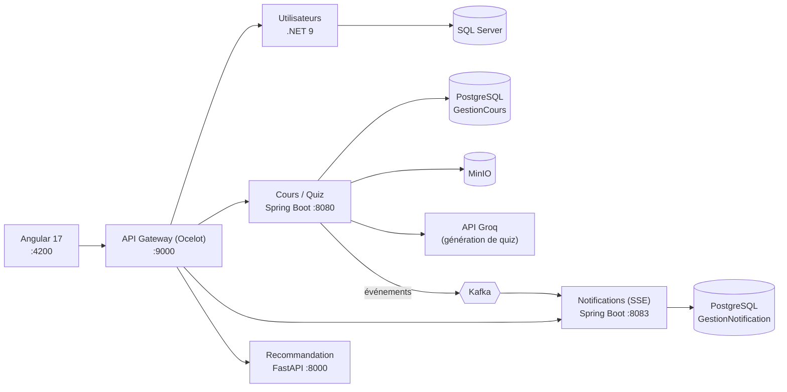

# 9raiti – Plateforme E-learning


**9raiti** est une plateforme d'apprentissage en ligne construite sur une **architecture microservices**. Elle permet aux enseignants de publier des cours et de créer des quiz (manuellement ou générés par IA à partir d'un PDF), et aux apprenants de suivre des cours, passer des quiz, interagir avec les contenus et recevoir des recommandations personnalisées et des notifications en temps réel.

Projet réalisé en équipe dans le cadre d'un projet de fin d'année (PFA) de Génie Informatique.

## Sommaire

- [Fonctionnalités](#fonctionnalités)
- [Architecture](#architecture)
- [Stack technique](#stack-technique)
- [Démarrage rapide](#démarrage-rapide)
- [Services et ports](#services-et-ports)
- [Configuration et secrets](#configuration-et-secrets)
- [API : routes exposées par la gateway](#api--routes-exposées-par-la-gateway)
- [Structure du dépôt](#structure-du-dépôt)
- [Limites connues et pistes d'amélioration](#limites-connues-et-pistes-damélioration)
- [Équipe](#équipe)

## Fonctionnalités

**Pour tous les utilisateurs**
- Inscription, connexion, déconnexion (avec invalidation du token) et connexion avec Google
- Confirmation de l'adresse email et réinitialisation du mot de passe par email
- Gestion du profil et de la photo de profil

**Apprenant**
- Parcours des catégories, modules et cours
- Inscription aux modules et suivi de ses inscriptions
- Quiz : passage, soumission et historique des tentatives
- Interactions sur les cours : likes, notes et commentaires
- Notifications en temps réel
- Recommandations de cours personnalisées

**Enseignant**
- Gestion de ses modules et de ses cours, avec téléversement de fichiers (stockage objet MinIO)
- Création de quiz et de questions, ou **génération automatique d'un quiz à partir d'un PDF** grâce à un modèle de langage (API Groq)
- Consultation de ses apprenants par module
- Compte soumis à la validation d'un administrateur

**Administrateur**
- Gestion des utilisateurs et validation des comptes enseignants
- Envoi de notifications à tous les utilisateurs ou à un rôle donné (broadcast)

## Architecture

Le frontend Angular communique avec une **API Gateway** (Ocelot) qui route les requêtes vers les microservices. Les événements (nouveau contenu, interaction, annonce admin) transitent par **Apache Kafka** et alimentent le service de notifications.



L'authentification repose sur des **JWT** émis par le service Utilisateurs et vérifiés par les autres services.

## Stack technique

| Couche | Technologies |
|---|---|
| **Frontend** | Angular 17 (composants standalone, lazy loading, guards d'authentification et de rôle), RxJS, Nginx |
| **API Gateway** | .NET 9, Ocelot, proxy SSE dédié pour les notifications |
| **Service Utilisateurs** | .NET 9, EF Core 9 + SQL Server, JWT Bearer, BCrypt, MailKit (SMTP), Google.Apis.Auth |
| **Service Cours / Quiz** | Java 17, Spring Boot 3.2, Spring Security, JPA/Hibernate, PostgreSQL, Spring Kafka, SDK S3 (MinIO), PDFBox |
| **Service Notifications** | Java 17, Spring Boot 3.2, Kafka (consommateur), Server-Sent Events, PostgreSQL |
| **Service IA** | Python 3.10, FastAPI, scikit-learn, pandas (filtrage collaboratif hybride) |
| **Infrastructure** | Docker, Docker Compose, Apache Kafka + Zookeeper, MinIO |

## Démarrage rapide

### Prérequis

- [Docker](https://docs.docker.com/get-docker/) avec Docker Compose v2
- Git
- Des ressources suffisantes : la stack lance une douzaine de conteneurs (SQL Server, Kafka, PostgreSQL, Spring Boot, etc.), prévoir plusieurs Go de RAM

### Lancement

```bash
git clone https://github.com/CharafAZIZI/9raiti-elearning-platform.git
cd 9raiti-elearning-platform
docker compose up --build
```

Le premier démarrage est long : les images sont construites et Docker attend que SQL Server, PostgreSQL, MinIO et Kafka soient prêts (health checks). Une fois les conteneurs démarrés, ouvrir **http://localhost:4200**.

Pour arrêter : `docker compose down` (ajouter `-v` pour supprimer aussi les volumes de données).

## Services et ports

| Service | URL / port hôte |
|---|---|
| Application Angular | http://localhost:4200 |
| API Gateway | http://localhost:9000 |
| Service Cours (Spring Boot) | http://localhost:8080 |
| Service Notifications | http://localhost:8083 |
| Service IA (FastAPI) | http://localhost:8000 (documentation Swagger sur `/docs`) |
| MinIO (API S3) | http://localhost:9002 |
| MinIO (console web) | http://localhost:9003 |
| Kafka | `localhost:9092` |
| SQL Server | `localhost:1434` |
| PostgreSQL (cours) | `localhost:5433` |
| PostgreSQL (notifications) | `localhost:5434` |

Le service Utilisateurs (.NET) n'est accessible que via la gateway.

## Configuration et secrets

Les valeurs présentes dans `docker-compose.yml`, `appsettings.json` et `application.properties` sont destinées au **développement local uniquement**. Pour utiliser les fonctionnalités qui dépendent d'un service externe, il faut fournir **vos propres identifiants** :

| Fonctionnalité | À configurer |
|---|---|
| Génération de quiz par IA | Clé d'API [Groq](https://console.groq.com) : variable `GROQ_API_KEY` du service `spring-service` |
| Emails (confirmation, mot de passe oublié) | Section `SmtpSettings` du service .NET (compte SMTP, par exemple un mot de passe d'application Gmail) |
| Connexion Google | `GoogleAuth:ClientId` du service .NET (identifiant OAuth créé dans la Google Cloud Console) |
| Signature des JWT | Clé secrète **identique** dans le service .NET (`Jwt:Key`) et dans les services Spring (`jwt.secret`) |

> ⚠️ Ne publiez jamais de vraies clés d'API, de mots de passe ou de secrets JWT dans le dépôt. Pour un déploiement, remplacez toutes les valeurs par défaut (mots de passe des bases de données, MinIO, clé JWT) et utilisez des variables d'environnement ou un gestionnaire de secrets. Les fichiers `.env` sont exclus par le `.gitignore`.

## API : routes exposées par la gateway

Toutes les requêtes passent par `http://localhost:9000`.

| Préfixe | Service cible | Contenu |
|---|---|---|
| `/api/auth`, `/api/users`, `/api/profile` | Utilisateurs (.NET) | Connexion, inscription, Google login, confirmation d'email, mot de passe oublié, gestion des utilisateurs et du profil |
| `/api/categories`, `/api/modules`, `/api/cours` | Cours (Spring) | Catalogue, modules, cours, téléversement et téléchargement de fichiers |
| `/api/inscriptions` | Cours (Spring) | Inscriptions des apprenants |
| `/api/interactions` | Cours (Spring) | Likes, notes, commentaires |
| `/api/quiz`, `/api/quiz-ai` | Cours (Spring) | Quiz, questions, tentatives, génération par IA |
| `/api/notifications` | Notifications | Liste, lecture, suppression, flux temps réel (SSE) |
| `/api/notifications/broadcast` | Cours (Spring) | Envoi de notifications par un administrateur |
| `/ai/recommend/{userId}` | IA (FastAPI) | Recommandations de cours pour un utilisateur |

## Structure du dépôt

```
9raiti-elearning-platform/
├── 9raiti/                      Frontend Angular 17
├── ApiGateway/                  API Gateway (.NET 9 + Ocelot)
├── MicroServiceDotNet/          Service Utilisateurs et authentification (.NET 9)
├── MicroServiceSpring/          Service Cours, modules, quiz, interactions (Spring Boot)
├── MicroServiceNotification/    Service Notifications temps réel (Spring Boot + Kafka)
├── MicroServiceIA/              Service de recommandation (FastAPI + scikit-learn)
├── docker-compose.yml           Orchestration de l'ensemble des services
└── .gitignore
```

## Limites connues et pistes d'amélioration

- [ ] Externaliser tous les secrets (fichier `.env`, secrets Docker) au lieu de les écrire dans les fichiers de configuration
- [ ] Ajouter des tests automatisés : seuls les tests de chargement de contexte Spring existent aujourd'hui
- [ ] Mettre en place une intégration continue (GitHub Actions) : build et tests de chaque service
- [ ] Restreindre les origines CORS et durcir la configuration pour la production
- [ ] Ajouter des captures d'écran et une documentation OpenAPI centralisée

## Équipe

Projet réalisé en équipe :

- Charaf AZIZI
- ayyoub ELMAHI
- zakaria ZAMMOURI
- Saoussane TAOUFIK
- dina ACHAHBOUN
